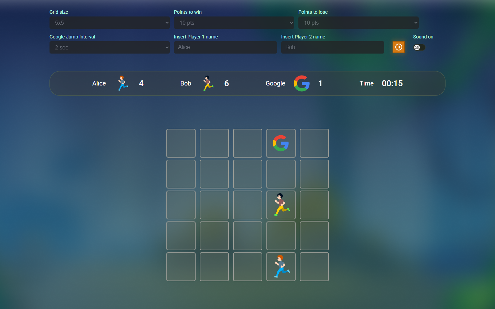
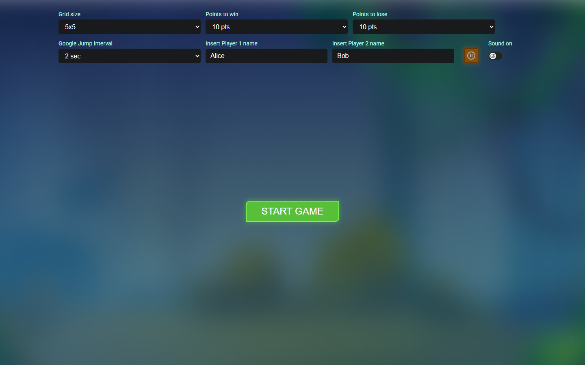
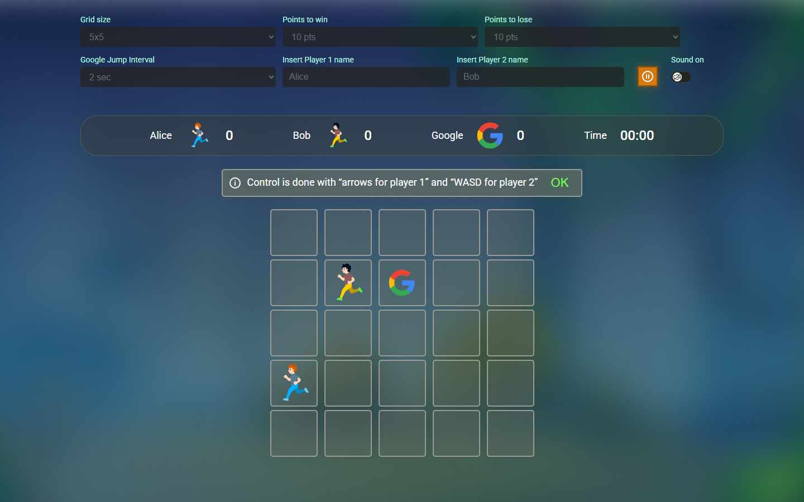
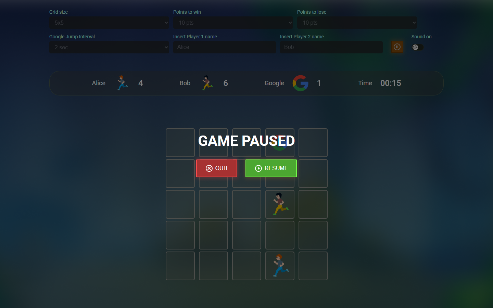
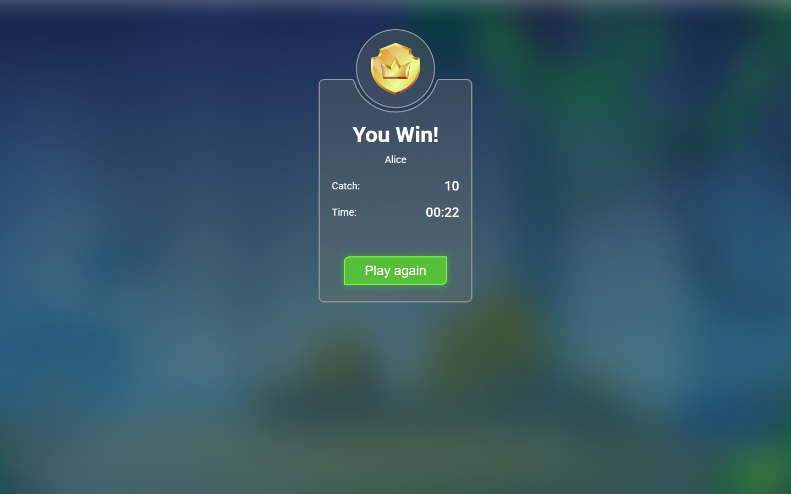
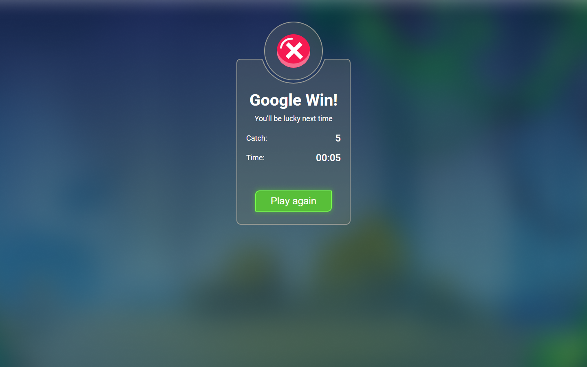

# Catch The Google

Браузерная игра для двух игроков: нужно поймать иконку Google, которая прыгает по полю, раньше, чем она наберёт свои очки. Играть можно вдвоём за одной клавиатурой или по сети с двух компьютеров.

**[▶ Играть онлайн](https://gromovaviktoriya.github.io/CatchTheGoogle/)**

> Сервер игры работает на бесплатном тарифе Render и засыпает после простоя. Первое подключение может занять около минуты, дальше всё работает без задержек.



## Скриншоты

| Настройки | Начало игры |
|---|---|
|  |  |
| **Пауза** | **Победа игрока** |
|  |  |
| **Победа Google** | |
|  | |

## Правила

- Google каждые N секунд перепрыгивает в случайную свободную клетку.
- Игрок, наступивший на клетку с Google, получает очко.
- Если Google успел прыгнуть и его никто не поймал, очко получает Google.
- Побеждает игрок, первым набравший нужное число очков. Если раньше нужное число набрал Google, побеждает он.
- Игроки не могут встать на одну клетку и блокируют друг другу дорогу.

## Возможности

- **Два режима игры**
  - *Одна клавиатура*: в игре одна вкладка, игрок 1 ходит стрелками, игрок 2 клавишами WASD.
  - *По сети*: две вкладки или два компьютера, каждый управляет только своим игроком. Сервер сам определяет, кто какой игрок, и не даёт управлять чужим.
- В игре не больше двух участников: третий подключившийся видит сообщение «GAME IS FULL».
- Настройки перед стартом: размер поля (4×4 – 8×8), очки для победы и поражения, скорость прыжков Google, имена игроков.
- Пауза, таймер, счёт, экраны победы и поражения, кнопка «Play again».
- Звуковые эффекты и фоновая музыка с переключателем.
- Если игрок отключился во время игры, она ставится на паузу.

## Стек и архитектура

- **Фронтенд**: чистый JavaScript (ES-модули), HTML, CSS, без фреймворков.
- **Бэкенд**: Node.js + [`ws`](https://github.com/websockets/ws) (WebSocket).
- **Тесты**: Jest.

Как устроено:

- **Вся игровая логика на сервере** (`core/game.js`). Клиент только отправляет команды (старт, ход, пауза) и отрисовывает присланное состояние, поэтому подменить счёт или ход с клиента нельзя.
- **MVC на клиенте**: `View` рисует интерфейс и ловит нажатия клавиш, `Controller` связывает его с моделью.
- **`GameProxy`** выдаёт себя за модель игры, а внутри общается с сервером по WebSocket. Контроллеру всё равно, где находится игра: локально или на сервере.
- **Observer**: модель уведомляет подписчиков об изменениях, а сервер рассылает новое состояние всем подключённым клиентам.
- **Dependency Injection**: генератор случайных чисел передаётся в `Game` снаружи, поэтому в тестах поведение Google предсказуемо.

```
├── core/              # Игровая логика (общая модель): Game, Player, Google, Position, настройки
├── back/back.js       # WebSocket-сервер: роли игроков, команды, рассылка состояния
├── game-proxy.js      # Клиентская «модель», которая проксирует вызовы на сервер
├── controller.js      # Controller (MVC)
├── view.js            # View (MVC): компоненты интерфейса, управление, звуки
├── index.js           # Точка входа клиента
├── css/, img/, sounds/
└── scripts/take-screenshots.js   # Автоматическая съёмка скриншотов для README
```

## Запуск локально

Нужны Node.js и pnpm (или npm).

```bash
pnpm install
pnpm start   # WebSocket-сервер на ws://localhost:8080
```

Затем откройте `index.html` в браузере через встроенный сервер WebStorm (Open in → Browser).
